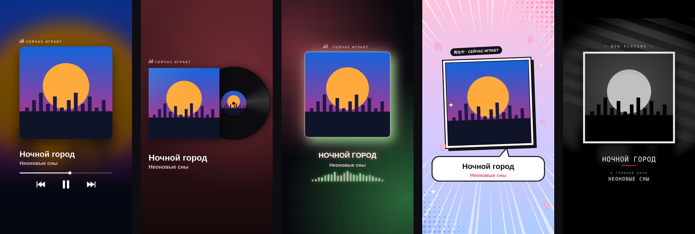

# 🎧 Сторис-трек

**Делись треками из Яндекс Музыки в сторис Instagram — красиво, в одно касание.**

В Яндекс Музыке есть классная кнопка «Поделиться в Instagram», которая делает красивую карточку трека для сторис. В России её отключили. Сторис-трек возвращает эту фичу и добавляет пять стилей на выбор.

## Как это работает

1. В Яндекс Музыке на любом треке нажми **Поделиться → Сторис-трек**.
2. Приложение само подтянет название, исполнителя и обложку.
3. Выбери стиль: **Размытие**, **Винил**, **Неон**, **Аниме** или **Нуар**.
4. Нажми **«В сторис»** → **Instagram → Истории**. Готово ✨

Кнопка ⬇ сохраняет карточку в галерею (альбом «Сторис-трек»).

## Установка

1. Открой [последний релиз](../../releases/latest) и скачай файл `story-track-*.apk`.
2. Открой скачанный файл. Android попросит разрешить установку из этого источника — разреши.
3. Если Play Защита предупредит о «неизвестном разработчике» — нажми «Всё равно установить»: приложение не из Google Play, поэтому так и должно быть.

Обновления ставятся поверх старой версии — удалять ничего не нужно.

**Требования:** Android 10 или новее. Для Instagram и стабильной работы сервиса в России нужен включённый VPN.

## Если что-то не так

- **Ничего не подтянулось** — вставь ссылку на трек в поле вручную и нажми ↻. Или впиши исполнителя и название — обложка найдётся по ним.
- **Обложка не та** — раскрой «Своя обложка», загрузи скрин плеера и подвинь рамку ползунками.
- **«Нет связи с сервером»** — включи VPN и нажми «Попробовать ещё раз».
- **«Слишком много запросов»** — подожди минутку: так сервис защищается от перегрузки.

## Приватность

Приложение не собирает и не хранит данные о тебе: никаких аккаунтов, аналитики и рекламы. На сервер уходит только ссылка на трек — чтобы получить название и обложку. Карточка рисуется прямо на телефоне.

## Как устроено

- **Android-приложение** (этот репозиторий) — лёгкая оболочка: принимает «Поделиться», показывает генератор карточек и отдаёт готовую картинку в Instagram.
- **Сервер** на Cloudflare Workers — генератор карточек и API, который по ссылке находит данные трека.
- APK собирается автоматически через GitHub Actions на каждое изменение и публикуется в [Releases](../../releases).

## Дисклеймер

Неофициальный проект. Не связан с Яндексом и Meta. «Яндекс Музыка» и «Instagram» — товарные знаки их владельцев. Данные о треках берутся из публичного, но неофициального API Яндекс Музыки, поэтому что-то может однажды перестать работать.

## Лицензия

[MIT](LICENSE)
